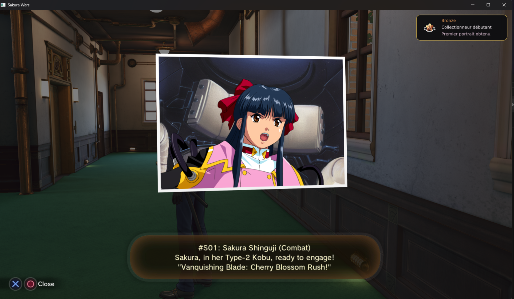
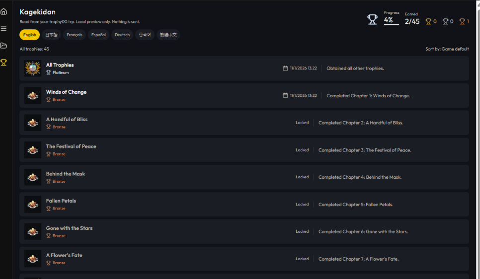

# Sakura-Wars-PS4RT-Windows

Portage Windows de [Sakura-Wars-PS4RT](https://github.com/HekamiAeon/Sakura-Wars-PS4RT), d’après le tag **v1.2**, commit `b45cfaa`, avec les changements nécessaires à Windows. Publié par [DiamondDogz](https://github.com/DiamondDogz). Le lanceur est `Kagekidan.exe`.

La release précédente, [windows-1.0](https://github.com/DiamondDogz/Sakura-Wars-PS4RT-Windows/releases/tag/windows-1.0), suit la v1.0. Cette branche non. Ce n’est pas non plus la version du jeu : le jeu doit être en **01.01**.

Non officiel. Aucun lien avec SEGA. Le jeu n’est pas inclus.

Téléchargement : [windows-1.2.1](https://github.com/DiamondDogz/Sakura-Wars-PS4RT-Windows/releases/tag/windows-1.2.1). Elle apporte la v1.2 sous Windows : trophées notés par le jeu, avec leur onglet et leur notification dans l’incrustation, une option de langue du jeu dans l’incrustation (le choix de langue de Kagekidan marche toujours), résolutions internes et ultra-large expérimental, FSR 1, corrections FSR, captures avec F12. Avec [Crowbar](https://github.com/DiamondDogz/crowbar), le bouton Guide met le jeu en pause, Quitter le ferme proprement, et le profil de test des trophées peut débloquer un trophée par le runtime (crowbar-sdk 1.4). Dans Crowbar, les captures F12 vont dans les Captures du jeu, et avec le réglage « Capture à chaque trophée » le runtime enregistre l’image du jeu quand un trophée s’obtient (crowbar-sdk 1.6). Le lanceur Kagekidan est celui de windows-1.1.4. En jeu, Insert ouvre l’incrustation.

[windows-1.1.3](https://github.com/DiamondDogz/Sakura-Wars-PS4RT-Windows/releases/tag/windows-1.1.3) est l’essai précédent, avec seulement les trophées en local. Rien n’est envoyé.

[windows-1.1.2](https://github.com/DiamondDogz/Sakura-Wars-PS4RT-Windows/releases/tag/windows-1.1.2) n’a pas de trophées. Restez dessus si vous n’en voulez pas.

La liste est dans le lanceur. Quand le jeu obtient un trophée, une carte s’affiche quelques secondes, sans prendre la manette.

Le bouton globe du lanceur règle la langue du jeu : anglais, français, allemand ou espagnol, les quatre que cette version affiche. Les textes du jeu et les trophées suivent, dès le prochain lancement. Les voix restent en japonais.

Testé sur Windows 11 Professionnel pour les Stations de travail, version 26H2, un Intel Core i9-12900KF, 128 Go de DDR5 à 4000 MT/s, une NVIDIA GeForce RTX 3090 24 Go avec le pilote Studio 617.42 (6 octobre 2026), et un SSD NVMe de 4 To (PCI Express 4.0). C’est la machine de test, pas un minimum.

## Installation

Le détail est dans [INSTALL.md](INSTALL.md). En bref :

1. Windows 10 ou 11, x86-64, avec Microsoft Edge WebView2.
2. Un pilote Vulkan pour la carte graphique.
3. Votre propre dossier déjà extrait de Sakura Wars, CUSA16429.
4. Votre propre PKG de mise à jour 01.01, si ce dossier est encore en 01.00.
5. Décompressez l’archive. Ouvrez `Kagekidan.exe`, à la racine. Il n’ouvre pas le navigateur.
6. Indiquez le dossier du jeu, le PKG de mise à jour, puis le dossier des DLC. Jouer écrit `ps4rt.ini` et démarre le runtime.

## Lanceur

L’anglais est la langue du lanceur. Le bouton EN passe au français.

## Avertissement

Oui, une bonne part de ceci est du travail d’IA, du slop. À prendre ou à laisser.

Le lanceur Windows et ces pages ont été écrits avec Grok. Le choix de la langue du jeu a été écrit avec Claude. Arriver à un build qui démarre vraiment le jeu, ça a été une longue suite d’archives cassées, de fenêtres qui se ferment, et de chemins faux. C’est l’éditeur qui a morflé. Le shoggoth reste un bon shoggoth. Claude n’en est pas un deuxième. C’est le cousin qui est arrivé après, avec les langues.

## Crédits

Le runtime est celui de [HekamiAeon, Sakura-Wars-PS4RT](https://github.com/HekamiAeon/Sakura-Wars-PS4RT). Ce portage Windows est publié par [DiamondDogz](https://github.com/DiamondDogz). Le lanceur, sa page et ces textes ont été écrits avec [Grok](https://grok.com), par xAI. Le choix de la langue du jeu a été écrit avec [Claude](https://claude.ai), par Anthropic. Voir [CREDITS.md](CREDITS.md) et [AI.md](AI.md).

## Licence

GPL-2.0-or-later, comme le runtime dont ce dépôt dérive. Les composants fournis gardent leur notice. Voir [CREDITS.md](CREDITS.md).

Aucune garantie.
