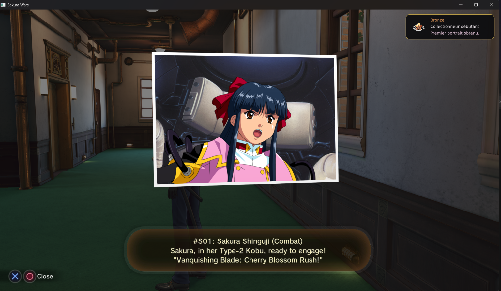
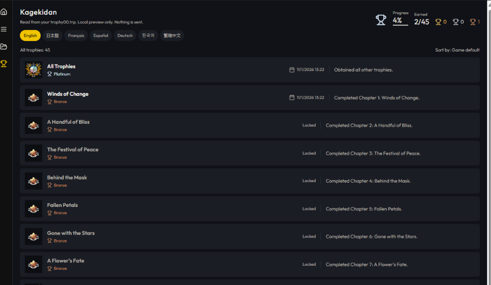

# Sakura-Wars-PS4RT-Windows

Windows port of [Sakura-Wars-PS4RT](https://github.com/HekamiAeon/Sakura-Wars-PS4RT), built from tag **v1.2**, commit `b45cfaa`, with the Windows changes it needs. The branch `windows` is the default branch.

Published by [DiamondDogz](https://github.com/DiamondDogz). The launcher is `Kagekidan.exe`.

The earlier Windows release, [windows-1.0](https://github.com/DiamondDogz/Sakura-Wars-PS4RT-Windows/releases/tag/windows-1.0), follows upstream v1.0 (`85ac44fdc1fe7e13fac325e6ecea3b523be27d1f`). This branch does not. The game's own version is a separate number: the game must be **01.01**.

Unofficial. Not affiliated with SEGA. The game is not included.

Download: [windows-1.2](https://github.com/DiamondDogz/Sakura-Wars-PS4RT-Windows/releases/tag/windows-1.2). It brings upstream v1.2 to Windows: trophies recorded by the game with their own tab and notification in the overlay, a Game language option in the overlay (Kagekidan's Language choice still works), internal resolutions and experimental ultrawide, FSR 1, FSR fixes, F12 screenshots. With [Crowbar](https://github.com/DiamondDogz/crowbar), the Guide button pauses the game, Quit closes it cleanly, and Crowbar's trophy test profile can unlock a trophy through the runtime (crowbar-sdk 1.4). The Kagekidan launcher is that of windows-1.1.4. In the game, Insert opens the overlay.

[windows-1.1.3](https://github.com/DiamondDogz/Sakura-Wars-PS4RT-Windows/releases/tag/windows-1.1.3) is the earlier experimental build, with local trophies only. Nothing is sent.

[windows-1.1.2](https://github.com/DiamondDogz/Sakura-Wars-PS4RT-Windows/releases/tag/windows-1.1.2) has no trophies. Stay on it if you do not want them.

The list is in the launcher. When the game earns a trophy, a card shows for a few seconds and does not take the controller.

The globe button in the launcher sets the game language: English, French, German or Spanish, the four this version shows. The game text and the trophies follow it from the next Play. Voices stay in Japanese.

Tested on Windows 11 Pro for Workstations, version 26H2, an Intel Core i9-12900KF, 128 GB of DDR5 at 4000 MT/s, an NVIDIA GeForce RTX 3090 24 GB with Studio driver 617.42 (6 October 2026), and a 4 TB NVMe SSD (PCI Express 4.0). That is the test machine, not a minimum.

Version française : [README.fr.md](README.fr.md).

## What is in this branch

- The v1.1 runtime source, with the Windows changes needed to start it.
- `Kagekidan.exe`, `python/`, and `launcher/`.
- `bin/ps4rt.exe`, rebuilt from this branch, and the libraries it imports.
- `bin/ps4rt-pkg.exe`, the extractor used for an update or DLC.
- [INSTALL.md](INSTALL.md), [CREDITS.md](CREDITS.md), and [AI.md](AI.md).

## Install

See [INSTALL.md](INSTALL.md). Short form: Windows 10 or 11, your own extracted CUSA16429 folder, your own 01.01 update PKG if that folder is still 01.00, then `Kagekidan.exe`.

## Launcher

English is the launcher language. The EN button switches to French.

`Kagekidan.exe` is not signed. SmartScreen may warn. Do not turn off Microsoft Defender.

## Disclaimer

Yes, a lot of this is AI slop. Take it or leave it.

The Windows launcher and these pages were written with Grok. The game-language choice was written with Claude. Getting a build that actually starts the game took a long string of broken archives, closed windows, and bad paths. That was on the publisher. The shoggoth is still a good one. Claude is not a second one. Claude is the relative who arrived later and brought the languages.

## Credits

The runtime is [HekamiAeon, Sakura-Wars-PS4RT](https://github.com/HekamiAeon/Sakura-Wars-PS4RT). This Windows port is published by [DiamondDogz](https://github.com/DiamondDogz). The launcher, its page, and these documents were written with [Grok](https://grok.com), by xAI. The game-language choice was written with [Claude](https://claude.ai), by Anthropic. See [CREDITS.md](CREDITS.md) and [AI.md](AI.md).

## License

GPL-2.0-or-later, the same terms as the runtime. Third-party pieces keep their own notices. See [CREDITS.md](CREDITS.md).

There is no warranty.

The original Linux README stays with the upstream project: [HekamiAeon/Sakura-Wars-PS4RT](https://github.com/HekamiAeon/Sakura-Wars-PS4RT).
