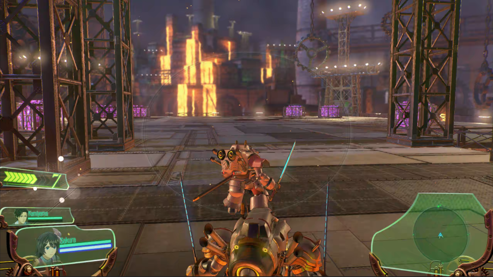

# Sakura Wars (PS4, CUSA16429): PS4RT for PC Linux Port

An experimental, game-specific Linux compatibility runtime for **Sakura Wars**
(PlayStation 4, **CUSA16429 v1.01**), tested on **Fedora Linux, x86-64**.

PS4RT prepares and runs the game's original x86-64 code on a Linux host, supplies
compatibility implementations of the PS4 services it needs, and uses a Vulkan
graphics renderer derived from shadPS4. This is **not a general-purpose PS4
emulator**, a native recreation of the game, or a replacement for owning the
game.

<p align="center">
  
</p>

**No game files, firmware, PKGs, decryption keys, or saves are supplied.** You
must provide your own extracted, plaintext **CUSA16429** game folder and, if
needed, your own matching v1.01 update PKG. The portable includes its own
native update/DLC installer; players do not need a separate PKG extractor.
It does not download games or connect to PSN. This project is not affiliated
with Sega, Sony, or AMD.

## Download and play (no compiling required)

**Want to play? Use the prebuilt Linux release. You do not need to compile
PS4RT or install FFmpeg, SDL3, Crypto++, or other bundled application
libraries.**

1. **Download:** Use the [latest GitHub release](https://github.com/HekamiAeon/Sakura-Wars-PS4RT/releases/latest) and choose the player archive containing **`linux-x86_64`** in its filename, not the separately labeled `source` archive.
2. **Have your own extracted PS4 game:** The launcher needs a plaintext **`CUSA16429` folder** containing `sce_sys/param.sfo`, `eboot.bin`, `sce_module/`, and the game's data. Point to **the CUSA16429 folder itself**, not a PKG, its parent folder, or `eboot.bin`. Version **1.00 or 1.01** may be supplied; **v1.01 is required to play**.
3. **Extract the downloaded archive** using your file manager. Open a terminal inside its extracted folder.
4. **Launch** with the path to your extracted `CUSA16429` folder:

```bash
bash Play-Game.sh --game "/path/to/CUSA16429"
```

**After a successful first setup**, the validated game folder is remembered inside the portable. For future launches, simply run `bash Play-Game.sh`. Supply `--game` again if you move the extracted folder or want to select a different copy. Failed updates never replace the remembered path.

**That's all you need to begin setup.** Keep the extracted release folder
together and writable. Paths containing spaces must be inside quotes, as
shown. The first run prepares the game's working files inside the portable.

**IMPORTANT: If your game is v1.00, the update installer modifies the selected
extracted CUSA16429 folder in place.** It replaces/adds the files supplied by
the v1.01 update; it does **not** preserve a second original v1.00 copy.
**Back up or duplicate your v1.00 game folder first** if you need to keep that
version for another application. This is different from the Star Ocean port.
Your original update PKG is not modified, and PS4RT saves and settings remain
inside the portable.

### First launch: required v1.01 update

- **Already have extracted v1.01?** The launcher detects it and starts the
  normal game-preparation sequence. No update installation is required.
- **Have extracted v1.00?** A graphical setup window asks you to select your
  own **matching Sakura Wars CUSA16429 v1.01 update PKG**. Select the update,
  confirm **Apply Update**, and allow the native extractor to finish. The
  installer validates the game/update metadata, applies the files, and checks
  the updated executable before launching. The progress bar tracks setup
  stages, not elapsed time or bytes copied.
- **After a successful v1.00 update**, PS4RT offers an **optional DLC
  picker**. Select your own matching DLC PKGs or choose **Close and launch
  game** to skip. The launcher then restarts automatically into v1.01.
  Cancelling or failing the required update prevents v1.00 from launching.
- **Already on v1.01?** Normal launches never open an update or DLC prompt.
  You can install DLC later using **Install DLC...** in the in-game PS4RT
  overlay. Installed DLC remains separate from base-game files.

If an update is interrupted, relaunch and select the **same v1.01 update
PKG** to recover the installation. See [Player update and DLC setup](docs/PLAYER_PKG_SETUP.md)
for details and advanced command-line options.

**Graphics are controlled in-game.** Hold **L2** and click the right stick
(**R3**) to open PS4RT settings, or press **Insert** on a keyboard. Use the
D-pad to navigate, Cross to confirm, and Circle to go back. Choose output
resolution (1080p, 1440p, 4K), upscaling (Off, FSR 3.1, or FSR 4 v07 where
supported), sharpening, anisotropic filtering, and the Sakura-specific
options described below.

**You do NOT need to specify graphics settings at launch.** If preferred,
you can start with FSR 4 and 4K output using optional overrides:

```bash
bash Play-Game.sh --game "/path/to/CUSA16429" --upscaler fsr4 --output-resolution 4k
```

**Changing anisotropic filtering (AF) requires restarting the game.**
Use **Restart Game** in the PS4RT overlay after saving progress.

**Player requirements:** x86-64 Linux with glibc **2.35 or newer**, Python 3,
a working Vulkan loader/driver (Vulkan 1.3), and compatible host display/input
libraries. Required application libraries, including SDL3, FFmpeg, and
Crypto++, are bundled. No compiler, external extractor, or special
`LD_LIBRARY_PATH` command is needed. Fedora gameplay has been verified;
other Linux distributions and hardware combinations are not all validated.

**Architecture support:** The portable targets native **x86-64/AMD64** CPUs.
ARM64 devices and CPU translation layers such as FEX or Box64 are **not
supported or validated**.

For more help, see [Running on Linux](docs/RUNNING_LINUX.md). The release
does **not** contain PS4 game files or firmware.

## Current status

**Experimental and playable through Chapters 1–3; not a verified full
playthrough.** Gameplay has been tested on Fedora with AMD/RADV graphics,
including story progression, cinematics, menus, audio, controller input,
combat, and saving/loading through **Chapter 3**. Chapters 4 onward and
other hardware/distribution combinations have not been comprehensively
verified. Please report reproducible issues, especially in later chapters.

- SDL-compatible gamepads, including DualSense and XInput, plus keyboard
  controls.
- **1080p, 1440p, and 4K output**, with **FSR 3.1**, optional **FSR 4 v07**,
  and sharpening. Higher output resolutions use upscaling/reconstruction;
  this is not a claim of native 4K game rendering.
- **Anisotropic filtering:** Game default, 2×, 4×, 8×, or 16×. AF is separate
  from anti-aliasing and requires restarting the game.
- **Custom Sakura Wars PS4RT overlay**, with artwork and menu sounds.
  Open using **Insert** or **L2 + R3 click**. Settings are saved when the
  overlay closes.
- **Outlines (visual preference):** The original game's rendering includes
  hard ink-like edges on surfaces such as walls, chairs, fixtures, and doors.
  Those interior edges can shimmer noticeably, even at higher resolutions.
  Choose **Full** for the original appearance, **Silhouettes only** to keep
  character silhouettes while suppressing many surface-crease edges, or
  **Off** to disable outlines. This is an optional aesthetic preference,
  **not a workaround for a port-specific defect** and **not a performance
  optimization**. Some shimmer is inherent to the original presentation.
- **60 FPS patch (experimental):** Sakura Wars does not provide a simple
  framerate-unlock toggle. Its 30 FPS assumptions are spread throughout the
  game logic. PS4RT contains numerous game-specific fixes for movement,
  timing, combat, and effects to make 60 FPS playable through the tested
  **Chapters 1–3**. The mode is believed to be largely functional, but
  chapters beyond those tested may still expose timing or visual defects.
  **30 FPS remains the default.** If something looks or behaves incorrectly
  at 60 FPS, reproduce it at **30 FPS** before reporting it, and mention
  whether it disappears. Late-game reports are particularly appreciated.
- **Install DLC:** The overlay's **Game > Install DLC...** action opens the
  native DLC PKG picker so you can install add-ons after the initial setup.
  The installer checks that the selected content belongs to CUSA16429,
  skips duplicates, and keeps installed DLC separate from the base game.
  **Save and restart** after installing new DLC to make it available; there
  is no hot-reloading into the running game.
- **Restart Game:** Closes the current running game and launches it again
  through the PS4RT launcher. This new PS4RT feature applies settings that
  require a restart and discovers newly installed DLC. **Save first**,
  because restarting does not automatically save your game.
- Other overlay options include display mode, VSync, and performance
  information.

FSR 3.1 is available in the runtime. FSR 4 v07 assets and their license
notice are included under `fsr4_shaders/`. FSR 4 requires appropriate
Vulkan GPU features, including INT8 dot-product support; unsupported
hardware can use FSR 3.1 instead. These assets are upscaler dependencies,
not shaders extracted from the game.

### Known limitations and bug reports

- **Chapters 4 onward are not fully verified.** Treat the optional 60 FPS
  patch as experimental outside the tested Chapters 1–3.
- **Native shimmering:** Some wall, fixture, and other surface-edge shimmer
  is part of Sakura Wars' own presentation. The Outlines setting offers a
  visual trade-off; it is not a renderer repair.
- **Japanese DLC text:** Certain Japanese-region DLC may show missing
  costume/selection labels because their text resources differ. The DLC
  content itself can still install and function.
- **DrawPipeline is unsupported and off by default.** Enabling it may help
  CPU-limited systems but can cause flickering or missing UI/fade draws.
  Bug reports must reproduce with DrawPipeline off. To experiment:

```bash
PS4RT_DRAW_PIPE=1 bash Play-Game.sh --game "/path/to/CUSA16429"
```

Disable it again with `PS4RT_DRAW_PIPE=0` or leave the variable unset.
Please use [GitHub Issues](https://github.com/HekamiAeon/Sakura-Wars-PS4RT/issues)
for reports. For a potential 60 FPS defect, include the chapter/scene,
your graphics settings, and the result at 30 FPS.

## Build from source (developers only)

**Downloaded the prebuilt Linux release? Skip this section.** The commands
below are for contributors. Players should use `Play-Game.sh` as shown
above.

From a source checkout, install a C/C++ toolchain, CMake 3.24+, Ninja,
pkg-config, Python 3, glslang, and development packages for Vulkan, SDL3,
FFmpeg, X11, fmt, Boost, xxHash, robin-map, Zydis, and other source
dependencies. **Unlike Star Ocean, Sakura Wars also needs Crypto++ and zlib
development packages** for its built-in native PKG extractor. Exact package
names vary by distribution (for example, `cryptopp-devel` and
`zlib-devel` on Fedora).

```bash
PS4RT_LTO=OFF bash build.sh --test
bash run.sh --game "/path/to/CUSA16429"
```

The test build runs automated tests, not a full playthrough. Source builds
create generated runtime data under `out/CUSA16429/`. **Be aware that the
integrated updater will modify a v1.00 `--game` folder in place**, so
developers should use a disposable copy when testing update installation.
Already-updated v1.01 data does not need updating.

To create the portable Linux release using the controlled Ubuntu 22.04 /
GCC 14 / glibc 2.35 builder, see [Linux portable build instructions](packaging/linux/README.md)
and the [distribution guide](docs/DISTRIBUTING_LINUX.md). The portable
builder also stages the native PKG installer, setup UI, and corresponding
dependencies.

### Keyboard and controller remapping

Default keyboard controls include **WASD** (left stick), **arrow keys**
(right stick), **Space** (Cross), **Left Shift** (Circle), **E** (Square),
**Q** (Triangle), and **I/J/K/L** (D-pad).

You can remap PS4 buttons at launch using `PS4RT_KEY_MAP`:

```bash
PS4RT_KEY_MAP="cross=Q,triangle=Space" bash run.sh --game "/path/to/CUSA16429"
```

`PS4RT_PAD_MAP` similarly remaps gamepad buttons. These are environment
variables, **not settings in `ps4rt.ini`**. There is no in-game
key-binding editor. The mapping defaults live in
[`src/runtime_pad.c`](src/runtime_pad.c), and these remaps do not change
analog axes or the PS4RT menu shortcut.

### Saves and private files

The source checkout or extracted portable keeps generated game code,
settings, saves, installed DLC, and GPU caches under `out/CUSA16429/`.
Notable paths:

- `out/CUSA16429/ps4rt.ini`: saved graphics settings.
- `out/CUSA16429/user/savedata/`: user save data.
- `out/CUSA16429/user/savedata-backups/`: save backups, when present.
- `out/CUSA16429/user/gpu/cache/CUSA16429/`: GPU shader/pipeline caches,
  when present.
- `out/CUSA16429/player-content/dlc/`: DLC installed using the PS4RT
  setup UI.

**Never publish `out/`.** It can contain game-derived binaries,
private saves, DLC files, and caches. No proprietary game material or
user data belongs in source control or public player archives.

## Credits, origins, and license

This Sakura Wars-specific project is **adapted open-source compatibility
software**, not a clean-room implementation. Its runtime builds on work
from:

- [FelipePrado0/gow3_pc](https://github.com/FelipePrado0/gow3_pc),
  the original PS4 compatibility-runtime lineage.
- [deadinside28/bloodborne_pc](https://github.com/deadinside28/bloodborne_pc)
  and [Supermedo/bloodborne_pc](https://github.com/Supermedo/bloodborne_pc),
  earlier compatibility-runtime and launcher adaptations.
- [shadPS4](https://github.com/shadps4-emu/shadPS4) and related Vulkan
  renderer and shader-recompiler contributors.
- [AzaharPlus/shadPS4Plus](https://github.com/AzaharPlus/shadPS4Plus),
  source of the adapted native PKG/PFS extraction code.

Development used [REA: Reverse Engineer Anything](https://github.com/morluto/rea)
and [Ghidra](https://github.com/NationalSecurityAgency/ghidra) as
reverse-engineering analysis tools, not embedded runtime code.

See [Upstream credits and notices](docs/UPSTREAM_CREDITS.md) for
additional contributors and third-party licenses. The runtime source is
distributed under **GPL-2.0-or-later**; vendored components retain their
own licenses and attribution. The FSR 4 assets have a separate notice at
[fsr4_shaders/LICENSE-FSR4-v07.txt](fsr4_shaders/LICENSE-FSR4-v07.txt).
A separate repository name or Git history does not remove obligations
to upstream contributors.

Sakura Wars is a trademark of its respective owners. This project is
not affiliated with or endorsed by them.
